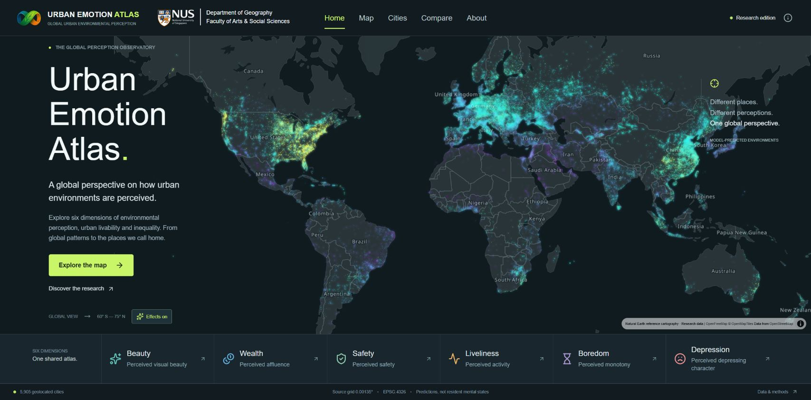
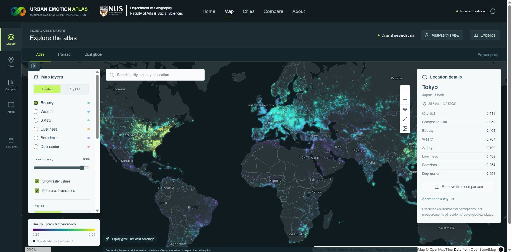
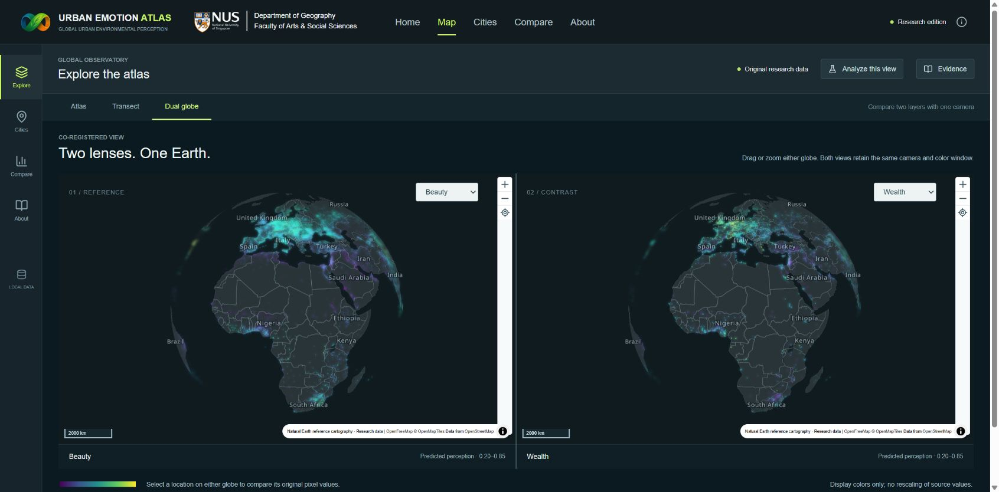
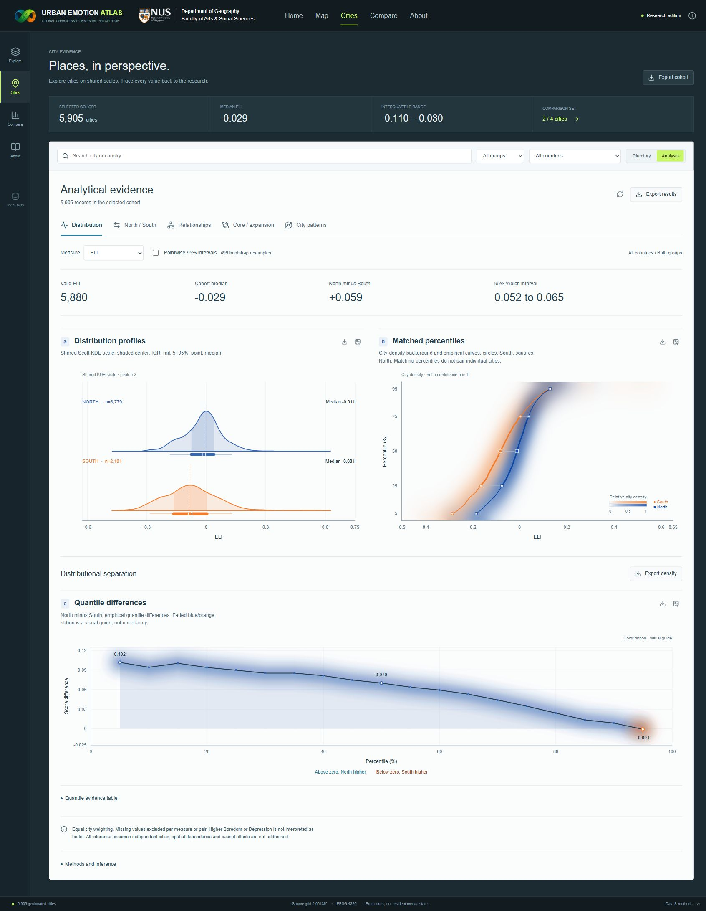

<div align="center">

# PerceptAtlas

**Quantifying and mapping global emotional livability**

Analysis code · Figure source data · Interactive research atlas

[**Explore the live atlas ↗**](https://perceptatlas.com/) · [**Download code + data**](https://github.com/DongXuEco/perceptatlas/releases/tag/v1.0.0) · [Figure guide](docs/FIGURES.md) · [中文说明](README.zh-CN.md)

</div>

[](https://perceptatlas.com/)

PerceptAtlas explores how urban environments are perceived, how perceptions vary within and between cities, and how they relate to environmental conditions. This repository accompanies the manuscript **Quantifying and mapping global emotional livability** and connects its processed numerical evidence to the corresponding analysis and plotting code.

| Study cities | Perceptual dimensions | Core–expansion pairs |
|:---:|:---:|:---:|
| **5,880** | **6** | **4,568** |

The six dimensions are **beauty, wealth, safety, liveliness, boredom and depression**. These are model-predicted perceptions of environments, not measurements of residents’ mental health. The emotional livability index (ELI) combines the four positive dimensions and the two negative dimensions; see the [definitions and reproduction guide](docs/REPRODUCIBILITY.md).

## Explore the web platform

The [live atlas](https://perceptatlas.com/) is the interactive companion to this repository. Browse global patterns, inspect locations, compare cities and examine distributional evidence.

| Explore places | Compare two layers |
|---|---|
| [](https://perceptatlas.com/#map) | [](https://perceptatlas.com/#map) |
| Raster layers, city ELI and native-pixel inspection | Camera-synchronized globes for contrasting perceptual layers |

<details>
<summary><b>See the city analysis workbench</b></summary>

[](https://perceptatlas.com/#cities)

Filter the cohort, compare North–South distributions, explore correlations and core–expansion contrasts, and export numerical evidence. [Platform guide →](docs/WEB_PLATFORM.md)

</details>

The website catalog contains **5,905 geolocated records**; the manuscript’s valid study cohort contains **5,880 cities**. Counts can differ further by measure and paired-data availability. Screenshots show the live interface and retain the displayed mapping attribution.

## Research at a glance

| Global perception patterns · Fig. 2 | Core–expansion disparities · Fig. 4 |
|---|---|
| [](docs/assets/research-global-patterns.png) | [](docs/assets/research-core-expansion.png) |
| [Plotting implementation](code/figures/Fig_2.py) | [Plotting implementation](code/figures/Fig_4.py) |

<details>
<summary><b>Environmental associations · Fig. 5</b></summary>


[Plotting implementation](code/figures/Fig_5.py). These analyses describe statistical associations and do not establish causal effects.

</details>

[Browse all 26 figure entries →](docs/FIGURES.md)

## Download and reproduce

**Download the attached [perceptatlas-research-v1.0.0.zip](https://github.com/DongXuEco/perceptatlas/releases/download/v1.0.0/perceptatlas-research-v1.0.0.zip) from the release.** It includes both the code and all 188 packaged data files. GitHub’s automatic **Source code** archive contains only the browsable repository, so it is not the data-inclusive package.

Extract the archive and open a terminal in its `perceptatlas/` directory. With Python 3.12:

```bash
python -m venv .venv
# Windows: .venv\Scripts\activate
# macOS / Linux: source .venv/bin/activate
python -m pip install -r code/requirements.txt
python code/figures/Fig_2.py --check-inputs
python code/figures/Fig_2.py --formats png pdf
```

Generated figures are written to `outputs/`. To inspect the available analysis tasks:

```bash
python code/run_analysis.py --list
```

Plotting scripts use the supplied numerical results and do not automatically retrain the association models. Some full analysis tasks require external rasters or substantial computation. See [reproduction instructions and limits](docs/REPRODUCIBILITY.md) before running them.

## Repository map

```text
code/
  figures/      Actual plotting implementations, named by manuscript figure
  analysis/     Processing, statistics, validation and association models
  _support/     Shared plotting functions, paths and command-line utilities
data/           Download instructions; full tables are in the release asset
docs/           Figure index, reproduction guide and platform gallery
figure_index.csv / figure_inputs.csv / data_dictionary.csv
reproduction_status.csv / external_inputs_required.csv / file_inventory.csv
```

| What you need | Where to start |
|---|---|
| Locate a manuscript figure | [Figure guide](docs/FIGURES.md) or [figure_index.csv](figure_index.csv) |
| Identify numerical inputs | [figure_inputs.csv](figure_inputs.csv), [data_dictionary.csv](data_dictionary.csv) |
| Run a plotting script directly | [code/figures](code/figures) |
| Inspect processing or statistics | [code/analysis](code/analysis) |
| Understand shared functions | [code/_support](code/_support) |
| Check external dependencies | [external_inputs_required.csv](external_inputs_required.csv) |

## Public release scope

This release supplies **processed figure-source tables, shared analysis inputs, analysis code and plotting implementations**. It excludes raw street-view images, original gridded perception datasets, data-download scripts, perception-scoring models, spatial-prediction pipelines, credentials and deployment files. Web application source and its raster service are not bundled; the live platform is showcased through links and screenshots.

The supplied validation record reports **12 passed figure entries using packaged inputs**. It does not certify reproduction of every manuscript figure: **14 entries require external inputs or configuration**. Figure 1 is a manually assembled composite with supporting illustration functions rather than a complete `Fig_1.py`; Supplementary Fig. S8 needs the historical walking configuration. [Detailed status →](docs/REPRODUCIBILITY.md)

## License and citation

- **Code:** [MIT](LICENSE).
- **Author-generated data:** [CC BY 4.0](LICENSE_DATA.md).
- **Third-party data, reference cartography and institutional marks:** retain their original terms; see [NOTICES.md](NOTICES.md).

Use [CITATION.cff](CITATION.cff) to cite this version. The manuscript title is *Quantifying and mapping global emotional livability*. A publication DOI is not assigned in this release.
